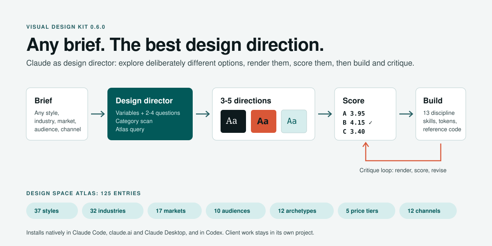

# Visual Design Kit



**Make Claude a design director for any style, industry, market and channel.** Visual Design Studio turns a brief into deliberately different design directions, renders them, scores them against the brief and recommends one. Then it carries the chosen direction through brand identity, UX, UI, web, native apps, motion, print and design systems, with concrete defaults instead of vague advice.

> **Status: supervised evaluation (0.6.0).** Installs natively in Claude Code, claude.ai and Claude Desktop, and in Codex. Every client deliverable still needs human review of the actual output. Regulatory notes are design guidance, not legal advice.

Version-Timestamp: 2026-10-20 11:00:00 UTC

[Install](#install) · [Use it](#use-it) · [What's inside](#whats-inside) · [How it finds the best solution](#how-it-finds-the-best-solution) · [Quality loop](#quality-loop) · [Client projects](#client-projects-and-continuity) · [What is verified](#what-is-verified) · [Develop](#develop-and-contribute)

## Install

**Claude Code**

```text
/plugin install visual-design-studio --marketplace newmindsgroup/visual-design-kit
```

or `/plugin marketplace add newmindsgroup/visual-design-kit`, then `/plugin install visual-design-studio@visual-design-team`.

**claude.ai and Claude Desktop:** Customize > Plugins > Add > Add marketplace > `newmindsgroup/visual-design-kit`.

**Codex:** `codex plugin marketplace add .` from a clone, then `codex plugin add visual-design-studio@visual-design-team`.

Details, version pinning and integrity checks: [INSTALLATION.md](INSTALLATION.md). No API keys or paid services are required.

## Use it

Ask in plain language; the right skill loads on its own.

| You say | What happens |
| --- | --- |
| "We're launching a debit card for students in Brazil. What should the brand look like?" | `design-director` extracts the variables, asks 2-4 questions that change the answer, queries the atlas, renders 3-5 directions and recommends one with a score table |
| "Critique this landing page" (with a file, URL or screenshot) | `design-critique` renders it at real sizes, scores it against a rubric, names generic-AI tells and gives prioritized fixes |
| "Set up our color tokens with dark mode" | `color` + `design-system` build DTCG tokens, contrast-checked in every mode |
| "Design the onboarding for our iOS app" | `native-app-design` + `ui-design` apply HIG specifics, states and accessibility |
| "Spec the animation for this bottom sheet" | `motion` gives durations, easing curves, choreography and reduced-motion behavior |
| "Print specs for a tri-fold brochure" | `print-packaging-social` gives trim, bleed, color, paper and preflight |
| "Put our tokens and components into Figma" (with a file link) | `figma-workflow` imports tokens as variables, builds bound components, maps Code Connect and proves each hop with screenshots |
| "Does the build match the approved design?" | `design-critique` runs `compare_build.mjs`: pixel and computed-style diff at real widths, with thresholds |

## What's inside

**Registered skills** (names and short descriptions stay in context; bodies load only when used):

| Skill | Covers |
| --- | --- |
| `design-director` | Brief intake, qualifying questions, atlas query, category scan, divergent directions, stylescapes, weighted scoring, recommendation |
| `brand-identity` | Strategy and positioning, naming, logo design and construction, identity systems, guidelines |
| `typography` | Selection, pairing, scales, setting, fluid type, licensing, multiscript |
| `color` | Palette architecture, OKLCH ramps, WCAG and APCA contrast, dark mode, color meaning |
| `layout` | Grids, spacing, composition, responsive recomposition, formats |
| `imagery` | Iconography, illustration systems, photo art direction, AI image generation, 3D |
| `motion` | Principles, timing and easing, choreography, kinetic type, CSS/GSAP/Lottie/Rive/Remotion/After Effects, sound |
| `ux-design` | Research, heuristics, UX laws, measurement, IA, journeys, content design |
| `ui-design` | Components and states, forms, navigation, data-dense UI, feedback, flows, AI and chat interfaces, accessibility |
| `web-design` | Page architecture, conversion, responsive, Core Web Vitals, SEO, stack selection, launch |
| `native-app-design` | iOS (HIG), Android (Material 3), cross-platform, large screens, app patterns, store assets, SwiftUI/Compose handoff |
| `design-system` | DTCG token architecture, theming, Figma variables and Code Connect, component APIs, documentation, governance |
| `data-visualization` | Chart choice, data palettes, labeling, dashboards, infographics, accessible charts |
| `print-packaging-social` | Prepress, packaging, social formats, OOH, presentations, email |
| `design-critique` | Render-screenshot-score-revise loop, rubric, AI-tells catalog, accessibility audit |
| `figma-workflow` | Token import to Figma variables, bound variant components, push and pull, Code Connect, Dev Mode handoff, no-connector fallback |
| `design-project-start` | Client-project continuity: pinned version, selections, decisions, approvals, resume, handoff |

**Specialist agents** (Claude Code and Cowork; chat falls back to one context): `direction-explorer` builds one direction per position in parallel for `design-director`; `art-director`, `accessibility-auditor`, `copy-editor`, `brand-guardian` and `frontend-engineer` form the `design-critique` review panel. Reviewers are read-only and return scores plus at most five fixes.

**Design Space Atlas:** 125 entries across 7 axes: 37 styles, 32 industries, 17 markets, 10 audiences, 12 brand archetypes, 5 price tiers and 12 channels. Each is a compact, opinionated brief with fonts, colors, scales, conventions, clichés, regulation and reference anchors. Query it with `python3 plugins/visual-design-studio/library/scripts/atlas.py query "<brief>"`. See the [atlas guide](plugins/visual-design-studio/library/atlas/README.md).

**Design tokens:** a W3C DTCG token set with primitives, semantic roles, light/dark/high-contrast modes and two brands, built to CSS, Tailwind v4, resolved JSON and Figma variables, with a linter that enforces WCAG contrast in every mode. See [tokens](plugins/visual-design-studio/library/tokens/README.md).

**Reference code:** a React + Tailwind + Radix component system wired to the tokens ([react-system](plugins/visual-design-studio/library/examples/react-system/README.md)) and Astro + Vue motion components ([astro-motion](plugins/visual-design-studio/library/examples/astro-motion/README.md)).

**Deep process library:** 133 process capabilities, templates and contracts for client delivery, linked from the skills ([catalog](docs/CAPABILITIES.md)).

## How it finds the best solution

```mermaid
flowchart LR
    A[Brief] --> B[Intake: variables and 2-4 questions]
    B --> C[Atlas: industry, market, audience, archetype, tier, channel]
    C --> D[Category scan: conventions and white space]
    D --> E[3-5 directions: expected, adjacent, breaking]
    E --> F[Stylescapes rendered and inspected]
    F --> G[Weighted scores and sensitivity check]
    G --> H[Recommendation and runner-up]
    H --> I[Discipline skills produce the work]
    I --> J[Critique loop until the rubric passes]
```



Directions must differ on at least three of six axes (type, palette, layout logic, imagery, motion, voice). Scores use weight presets for launches, regulated industries, rebrands and product UI, and the sensitivity check names the criterion that would flip the decision. See the [worked example](plugins/visual-design-studio/skills/design-director/references/worked-example.md).

## Quality loop

- **Stylescape calibration set:** 12 fictional brands rendered as complete stylescapes across very different styles, industries, markets and audiences, including RTL Arabic, Japanese, Portuguese and Spanish. See [stylescapes](plugins/visual-design-studio/library/examples/stylescapes/README.md).
- **AI-tells gallery:** named generic-AI design patterns, each shown next to a better version. See [ai-tells](plugins/visual-design-studio/library/examples/ai-tells/README.md).
- **Build fidelity:** `skills/design-critique/scripts/compare_build.mjs` diffs an approved design (PNG or HTML) against the build at real widths, pixel and computed style, and exits non-zero above threshold for CI.
- **Render review:** `skills/design-critique/scripts/render_review.mjs` screenshots any page at real widths and reports overflow, orphaned words, fonts, contrast and axe accessibility findings.
- **Evals:** 32 `claude plugin eval` cases compare Claude with and without the plugin on direction-finding, regulated industries, markets (Japan, Brazil, Quebec, Saudi Arabia), audiences, tokens, motion, native apps, packaging, data viz, email and critique, plus three controls that design skills stay out of unrelated work. Maintainers improve the kit with the [eval loop skill](.claude/skills/design-kit-eval-loop/SKILL.md).
- **Spec radar:** `tools/spec_radar.py` lists every volatile claim marked "verify" (regulation, platform specs, payments, statistics); a monthly review re-checks them against primary sources. See [spec radar](docs/SPEC-RADAR.md). See [evals](plugins/visual-design-studio/evals/README.md).
- **Earlier calibration:** the FORM and TIDAL [quality benchmark](plugins/visual-design-studio/library/examples/quality-benchmark/README.md) with correct, generic and wrong variants.

## Client projects and continuity

For client work that needs a frozen kit version and traceable approvals across sessions, keep each brand in its own folder or repository and use `design-project-start`. It records the pinned version (`library-version.json`), selected capabilities, decisions, approvals and `RESUME.md`, and keeps the shared library read-only. Setup, payload verification and the project entry template are in [INSTALLATION.md](INSTALLATION.md) and [project-starter](project-starter/README.md). Optional, owner-supplied reference books can be connected through [local setup](resources/LOCAL-SETUP.md); the kit works fully without them.

Lessons from projects come back through the [feedback contract](plugins/visual-design-studio/FEEDBACK.md): sanitized proposals, maintainer review, a test on the original and a contrasting case, then a versioned update that projects adopt deliberately.

## What is verified

| Area | Evidence (0.6.0 candidate) | Limit |
| --- | --- | --- |
| Claude packaging | `claude plugin validate` passes for the marketplace and both plugins; installed and enabled in Claude Code 2.1.304 (isolated config, 2026-10-20) | claude.ai and Desktop install follow the documented route; check in your workspace |
| Packaging rules | `tools/validate_plugin.py`: claude.ai-compatible frontmatter, description budget, version sync, every relative link resolves | Structural, not behavioral |
| Atlas | 125/125 entries validated against the schema; index regenerated and checked in CI | Platform specs and regulation change; entries are dated and say where to verify |
| Tokens | Lint enforces DTCG structure, alias resolution, contract names and WCAG contrast in every mode and brand | Brand-specific tokens still need human review |
| Automated tests | Repository and library Python suites, Node example tests and builds; all run in CI on every push | See [edition evidence](docs/RELEASE-060.md) for counts |
| Behavior | 32 eval cases ship with the plugin; see [edition evidence](docs/RELEASE-060.md) for what was run | Evals sample behavior; they do not certify every output |
| Codex | Earlier editions installed on the authoring Mac | Re-verify 0.6.0 on your host |
| Design quality | Calibration sets and the critique loop raise the floor | Human art direction and client approval remain required |

## Develop and contribute

Maintainers: start with [CLAUDE.md](CLAUDE.md) and the [authoring skill](.claude/skills/design-kit-authoring/SKILL.md) (writing rules, skill format, atlas schema, token contract). Run the checks:

```sh
python3 tools/validate_plugin.py
PYTHONDONTWRITEBYTECODE=1 python3 -m unittest discover -s tests
(cd plugins/visual-design-studio/library && PYTHONDONTWRITEBYTECODE=1 python3 -m unittest discover -s tests)
claude plugin validate . && claude plugin validate plugins/visual-design-studio
```

Contributions follow [CONTRIBUTING.md](CONTRIBUTING.md); security reports follow [SECURITY.md](SECURITY.md). [Development checks](docs/DEVELOPMENT.md) cover optional browser and export tooling.

## License

Original code, skills and documentation are [MIT](LICENSE). Bundled fonts are OFL-licensed with their license files; see [NOTICE.md](NOTICE.md) and [third-party dependencies](docs/THIRD-PARTY-DEPENDENCIES.md). Reference anchors name public work for orientation only; no third-party brand assets are included.

## Repository map

```text
visual-design-kit/
  .claude-plugin/marketplace.json      Claude marketplace (Claude Code, claude.ai, Desktop)
  .agents/plugins/marketplace.json     Codex marketplace
  .claude/skills/design-kit-authoring/ Maintainer authoring rules
  .claude/skills/design-kit-eval-loop/ Maintainer eval-driven improvement loop
  .github/workflows/ci.yml             Tests, validators and builds on every push
  CLAUDE.md                            Maintainer instructions
  INSTALLATION.md                      Install, pin and verify
  plugins/visual-design-studio/
    .claude-plugin/ .codex-plugin/     Plugin manifests (versions kept in sync)
    skills/                            17 registered skills
    agents/                            6 specialist subagents
    evals/                             claude plugin eval cases
    library/atlas/                     Design Space Atlas (125 entries)
    library/tokens/                    DTCG tokens and builds
    library/examples/                  Stylescapes, AI tells, benchmarks, React and Astro code
    library/draft-skills/              133 process capabilities for client delivery
    library/scripts/                   atlas, tokens, color and type tools (stdlib Python)
  extras/astro-website-studio/         Standalone Astro skill plugin
  tools/  tests/  docs/                Build, validation, spec radar, tests and edition records
```

## History

0.6.0 added specialist agents for parallel exploration and review, the Figma round trip, design-to-build fidelity checks, 32 eval cases with a maintainer improvement loop, and the spec radar ([edition evidence](docs/RELEASE-060.md)). 0.5.0 rebuilt the kit around Claude-native skills, the Design Space Atlas, concrete defaults, tokens and the quality loop after an [audit](docs/RELEASE-050.md) found the library was mostly process text with little design knowledge. Earlier editions: [0.4 motion atlas](docs/MOTION-ATLAS-040.md), [0.3 standalone methods](docs/STANDALONE-030.md), [0.2 quality release](docs/QUALITY-020-RELEASE.md), [public release](docs/PUBLIC-RELEASE-021.md). The [backlog](BACKLOG.md) tracks remaining work.
