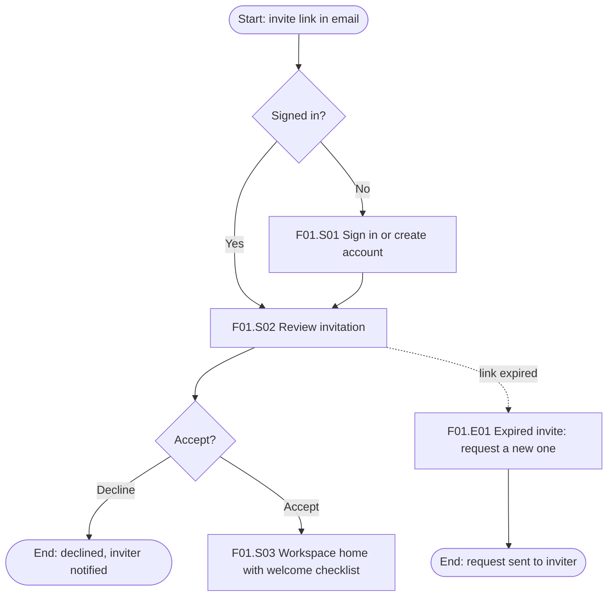

# Jobs, journeys and flows

Version-Timestamp: 2026-10-20 02:04:32 UTC

Each artifact answers a different question. Pick the one that serves the next decision, keep it evidence-linked, and give every step and state a stable ID so screens, copy and tests can refer to it.

## Choose the artifact

| Artifact | Answers | Scope | Inputs |
| --- | --- | --- | --- |
| Job story / JTBD | What progress is the person trying to make? | One job | Interviews, switch interviews |
| Journey map | What does one actor experience over time across touchpoints? | One actor, one scenario | Research, analytics, support data |
| Experience map | What does a type of person experience in a domain, independent of our product? | Broad | Generative research |
| Service blueprint | What must the organization do frontstage and backstage to deliver the journey? | One journey, all actors | Journey map, operations interviews |
| User flow | What paths can a user take through the product, including decisions and errors? | One goal, all entry points | Requirements, IA |
| Task flow | What are the steps of one bounded task? | One task, one path plus errors | Requirements |
| Wireflow | How do screens and their states connect? | A flow at screen level | User flow, wireframes |
| Story map | What do we build first? | Whole product or release | Flows, priorities |

## Jobs to be done

**Job story** (popularized by Alan Klement and Intercom): "When [situation], I want to [motivation], so I can [expected outcome]."

> When a client emails a last-minute change, I want to see which tasks it affects, so I can tell them the new delivery date before the call ends.

**Outcome statements** (Tony Ulwick, Outcome-Driven Innovation): direction + metric + object + clarifier, for example "Minimize the time it takes to find which tasks a change affects." Rate each outcome for importance and current satisfaction; high importance with low satisfaction marks an opportunity.

**Job dimensions.** Functional (get it done), emotional (feel in control), social (look competent to the client). Design and messaging should address all three.

**Forces of progress** (Bob Moesta and Chris Spiek): the push of the current situation and the pull of the new solution must outweigh anxiety about the new solution and the habit of the present one. Design to reduce anxiety (trials, import tools, undo, guarantees) and habit (migration, familiar patterns), not only to increase pull.

**Switch interview timeline.** First thought, passive looking, event that triggered active looking, deciding, first use, ongoing use. Ask what happened at each point and what almost stopped them.

## Journey maps

**Anatomy, top to bottom:**

1. Lens: actor (persona or role), scenario, goal and expectations.
2. Stages: 4-7 phases in the actor's terms (Notice, Research, Decide, Set up, Use, Get help), not the company's funnel names.
3. Doing: actions per stage.
4. Thinking: questions and expectations, from research quotes.
5. Feeling: an emotion curve plotted only where evidence exists, each point tagged with a source ID; gaps marked unknown.
6. Touchpoints and channels: web, app, email, phone, store, partner, paper.
7. Pain points and moments that matter.
8. Opportunities, each with an owner and a priority.

**Rules.** One actor and one scenario per map. Current-state maps come from research; future-state maps are proposals and are labeled as such. Show the peak and the end of the experience clearly (peak-end rule). Keep it to one screen or one wall; link to evidence rather than pasting it.

## Service blueprints

Lanes, top to bottom (G. Lynn Shostack, 1984; extended by Bitner, Ostrom and Morgan, 2008):

| Lane | Contents |
| --- | --- |
| Physical and digital evidence | What the customer sees: emails, screens, receipts, signage |
| Customer actions | Steps the customer takes |
| Line of interaction | |
| Frontstage actions | What staff or systems do in view of the customer |
| Line of visibility | |
| Backstage actions | Staff or system work out of view |
| Line of internal interaction | |
| Support processes | Systems, vendors, policies, other teams |

Add time per step, fail points (marked F), wait points (marked W), and the metrics or policies that govern each step. Blueprints expose where a beautiful interface promises something operations cannot deliver; fix the service, then the screen.

## User flows

**Notation.** Rounded rectangle: start or end. Rectangle: screen or step. Diamond: decision. Arrow: transition labeled with its trigger. Give each node an ID: `F03.S04` (flow 3, step 4), `F03.D02` (decision 2), `F03.E01` (error 1).

**Every flow includes:**

- All entry points: direct, search, deep link, email or push notification, ad landing page, returning user mid-task.
- The happy path in 3-7 steps where possible.
- Alternatives at each decision.
- Errors and their recovery: validation, payment declined, session expired, offline, permission denied, unknown outcome after a lost connection.
- Empty and first-use states.
- Cancel and back from every step, and what data is kept.
- The end: confirmation, next step, and where the person lands.

**Example (Mermaid):**

**Checks.** Every decision has all branches drawn. Every error has a recovery. Every path reaches an end. No step asks for data the system already has. Each screen in the flow has its state inventory below.

## State inventory per screen

For each screen ID list which of these exist and what each shows: default, loading, empty (first use, no results, cleared), partial data, error (inline, page-level, system-level), success, offline, permission denied or upgrade needed, read-only, in-progress by someone else. `ui-design` [states and feedback](../../ui-design/references/states-and-feedback.md) gives the patterns for each.

## Wireflows

Low-fidelity screens connected by labeled arrows. Use them for mobile apps and for screens whose content changes with state (filters, editors, multi-step dialogs), where a plain flow chart hides the layout problems. Show one frame per meaningful state, not per pixel change.

## Story maps

Jeff Patton's story map: the backbone is the sequence of user activities across the top; tasks hang below each activity, ordered by priority. Slice horizontally: the first slice is the walking skeleton, the thinnest end-to-end path that delivers value. Use it to decide release scope with engineering and product.

## From flows to requirements

| Req ID | Requirement | Source | Flow and state | Priority | Acceptance check |
| --- | --- | --- | --- | --- | --- |
| R-014 | Expired invite offers a one-tap request for a new invite | Support tickets, 2026 Q2 | F01.E01 | Must | Request reaches inviter; user sees confirmation |

Every requirement traces to a finding or a labeled hypothesis, and every acceptance check can be observed.
